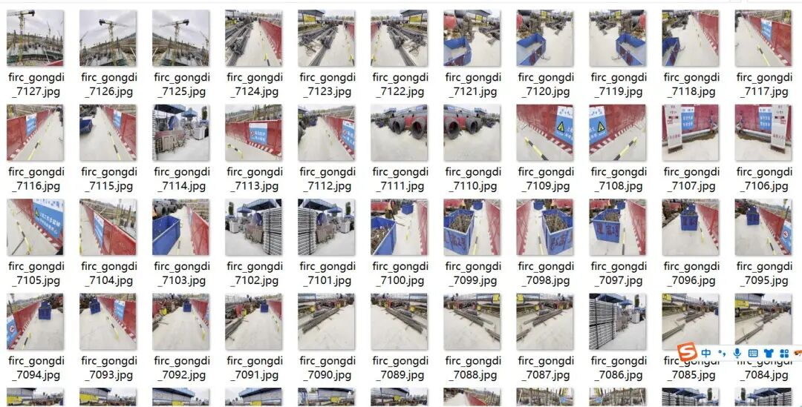
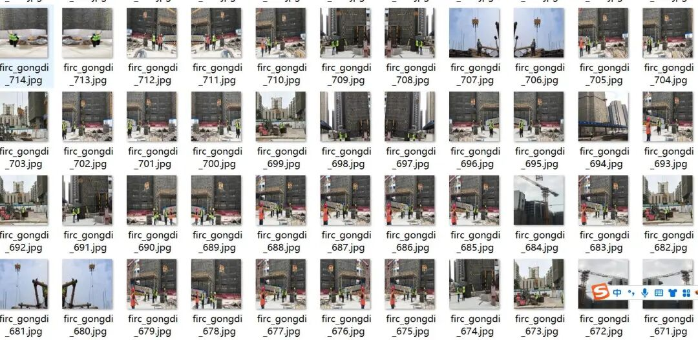
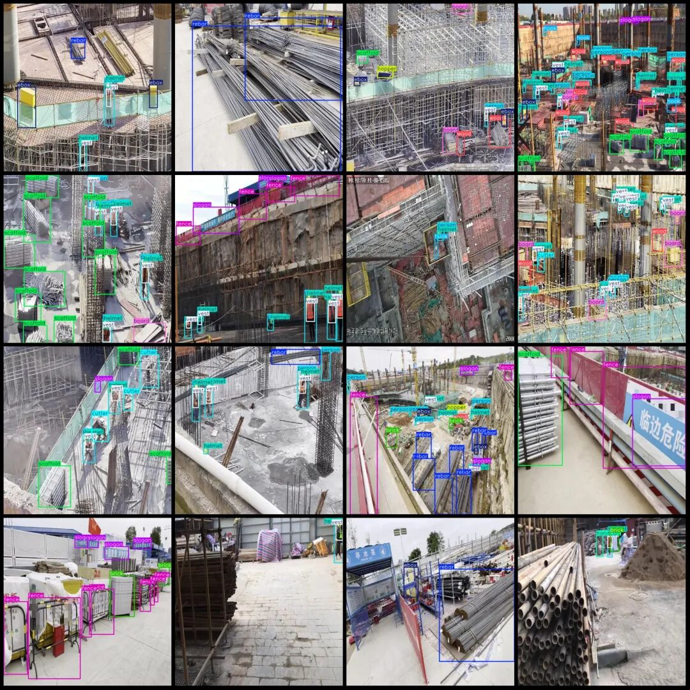

# Intelligent Construction Site - Building Site Safety Behavior Detection Dataset VOC+YOLO format with 13,364 images in 15 categories

Approximately half of the dataset consists of enhanced images, please refer to the image preview.

Dataset format: Pascal VOC format + YOLO format (txt file without split path, only containing jpg images and corresponding VOC format xml files and yolo format txt files)

Number of images (number of jpg files): 13364

Number of annotations (number of xml files): 13364

Number of annotations (number of txt files): 13364

Label category count: 15

Label category names (note that the order of categories in the YOLO format does not correspond to this, but is based on the classes.txt file in the labels folder): ["board", "brick", "cutter", "ebox", "fence", "handcart", "helmet", "hook", "hopper", "person", "rebar", "scaffold", "slogan", "vest", "wood"]

["Wooden board", "Bricks", "Cutting machine", "Electric box", "Fence", "Handcart", "Safety helmet", "Hook", "Material hopper", "Personnel", "Rebar", "Skids", "Billboard", "Backpack"]

Number of boxes labeled in each category:

Board Frames = 8319

Brick Frame Count = 2242

Cutter frame count = 1197

ebox box count = 5609

Fence frame count = 5581

Handcart frame count = 828

Helmet frame count = 37100

Number of hooks = 5637

Hopper frame count = 3504

Person Frames = 48633

Rebar frame count = 4474

Scaffold frame count = 17209

Slogan Frames = 12143

Vest Frame Count = 31336

Wood frame count = 11660

Total frame count: 195472

Using labelImg:

Annotation rules: Draw a rectangle around the category.

Important Notice: No

Special : This dataset does not guarantee the accuracy or precision of the trained models or weight files. The dataset is provided with accurate and reasonable annotations only.

Image Preview:

Annotation example:

## Payment

Here is a pay link on Stripe ( https://buy.stripe.com/3cs8yP7sY87d0vu9AB ). Please contact me lonlonago@foxmail.com after funding $89, and I will send you a complete data files , thank you!

